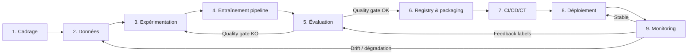
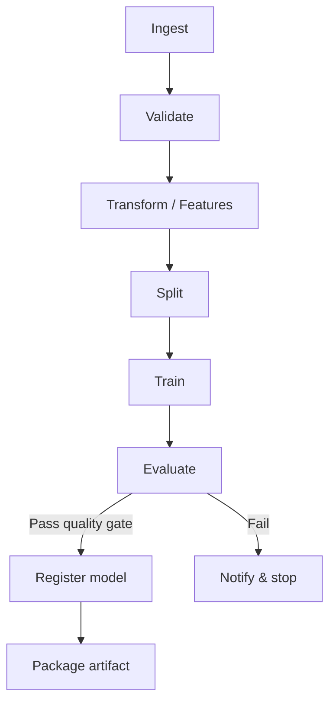
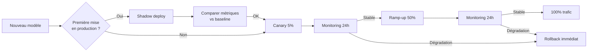
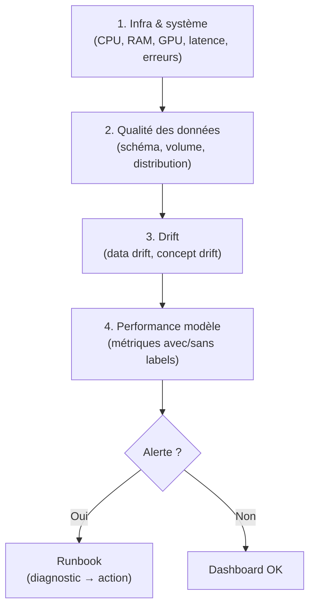
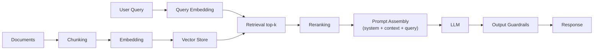

# 🚀 MLOps Playbook — `{{NOM_PROJET}}`

> **Version** : 1.0 · **Dernière mise à jour** : 2026-11-13 · **Auteur** : ML Platform Team

---

## TL;DR

1. Ce fichier est le **contrat opérationnel unique** pour tout projet ML, du POC à la production critique.
2. Chaque section suit : **Objectif → Règles (🟢🟡🔴) → Outils → Livrables → Definition of Done**.
3. Trois niveaux de maturité : 🟢 Essentiel (solo/POC) · 🟡 Standard (équipe/prod) · 🔴 Avancé (scale/critique/réglementé).
4. Les placeholders `{{…}}` sont renseignés dans la **Project Card** ci-dessous.
5. Les templates en annexe sont copiables tels quels.
6. La section 20 contient les **règles pour agents IA** (Claude Code, Cursor, Copilot).
7. Chaque règle est **opinionated** : pas de « ça dépend » sans règle de décision explicite.
8. Agnostique cloud/on-prem : principe d'abord, outil ensuite.
9. Le fichier couvre : tabulaire, vision, NLP, séries temporelles, RL, LLM/RAG.
10. Lisez les sections dans l'ordre lors du premier projet, puis utilisez les checklists (§17) en routine.

---

## Mode d'emploi

1. **Remplir la Project Card** (ci-dessous) avec les paramètres du projet.
2. **Choisir le niveau de maturité cible** (🟢, 🟡 ou 🔴) — appliquer uniquement les règles de ce niveau et en dessous.
3. **Copier l'arborescence** (§4) dans le repo.
4. **Parcourir chaque section** dans l'ordre pour le premier projet ; les suivants utilisent les checklists (§17).
5. **Agents IA** : pointer vers la section 20 dans le fichier de contexte du repo.

---

## Table des matières

- [0. Project Card](#0-project-card)
- [1. Principes directeurs](#1-principes-directeurs)
- [2. Cycle de vie end-to-end](#2-cycle-de-vie-end-to-end)
- [3. Cadrage](#3-cadrage)
- [4. Structure du repo & conventions](#4-structure-du-repo--conventions)
- [5. Données](#5-données)
- [6. Expérimentation](#6-expérimentation)
- [7. Entraînement & pipelines](#7-entraînement--pipelines)
- [8. Évaluation](#8-évaluation)
- [9. Model registry & packaging](#9-model-registry--packaging)
- [10. CI/CD/CT](#10-cicdct)
- [11. Déploiement & serving](#11-déploiement--serving)
- [12. Monitoring & observabilité](#12-monitoring--observabilité)
- [13. Infrastructure & coûts](#13-infrastructure--coûts)
- [14. Sécurité, gouvernance & conformité](#14-sécurité-gouvernance--conformité)
- [15. Extension LLMOps / GenAI](#15-extension-llmops--genai)
- [16. Organisation](#16-organisation)
- [17. Checklists finales](#17-checklists-finales)
- [18. Anti-patterns](#18-anti-patterns)
- [19. Stack de référence](#19-stack-de-référence)
- [20. Règles pour agents IA](#20-règles-pour-agents-ia)
- [Annexes](#annexes)

---

## 0. Project Card

> Remplir **avant** toute autre action. Chaque placeholder `{{…}}` du document renvoie ici.

| Variable | Valeur | Exemple |
|---|---|---|
| `{{NOM_PROJET}}` | | `fraud-detection-v2` |
| `{{TYPE_TACHE}}` | | `classification binaire`, `object detection`, `NER`, `forecasting`, `RL`, `RAG`, `text generation` |
| `{{DOMAINE}}` | | `finance`, `santé`, `e-commerce`, `industrie` |
| `{{METRIQUE_CIBLE}}` | | `F1`, `mAP@50`, `BLEU`, `RMSE`, `recall@95precision` |
| `{{METRIQUE_BUSINESS}}` | | `taux de fraude non détectée < 0.1 %`, `coût faux positif < 5 €/cas` |
| `{{BASELINE}}` | | `règle métier actuelle`, `modèle v1.2`, `random` |
| `{{SLO_LATENCE}}` | | `p99 < 100 ms` |
| `{{SLO_DISPONIBILITE}}` | | `99.9 %` |
| `{{BUDGET_INFERENCE}}` | | `< 0.001 $/requête` |
| `{{VOLUME_DONNEES}}` | | `10 M lignes`, `500 k images`, `2 TB texte` |
| `{{FREQUENCE_RETRAIN}}` | | `hebdomadaire`, `mensuel`, `on-drift` |
| `{{CLOUD_PROVIDER}}` | | `AWS`, `GCP`, `Azure`, `on-prem`, `hybride` |
| `{{GPU_CIBLE}}` | | `T4`, `A100`, `H100`, `CPU-only` |
| `{{NIVEAU_MATURITE}}` | | 🟢 / 🟡 / 🔴 |
| `{{CONFORMITE}}` | | `RGPD`, `EU AI Act haut risque`, `HIPAA`, `SOC2`, `aucune` |
| `{{EQUIPE}}` | | `1 ML eng`, `3 ML + 1 DE + 1 SRE` |
| `{{REPO_URL}}` | | `github.com/org/{{NOM_PROJET}}` |
| `{{REGISTRY_URL}}` | | `mlflow.internal.company.com` |
| `{{HYPOTHESES}}` | Les données sont disponibles en accès direct (pas d'API tierce bloquante). L'infra GPU est provisionnée. Le labeling est fait ou budgété. | |

---

## 1. Principes directeurs

> Les 10 règles non négociables. Toute décision du projet doit pouvoir se justifier par un de ces principes.

| # | Principe | Implication concrète |
|---|---|---|
| 1 | **Reproductibilité totale** | Seed, version des données, version du code, version de l'env → même résultat. |
| 2 | **Automatiser d'abord, optimiser ensuite** | Un pipeline bancal automatisé bat un notebook parfait lancé à la main. |
| 3 | **Le code ML est du code** | Tests, revue, linting, typing, CI — aucune exception pour les notebooks. |
| 4 | **Les données sont un livrable versionné** | Pas de « j'ai modifié le CSV sur le serveur ». |
| 5 | **Métrique business > métrique ML** | Un modèle qui monte en accuracy mais dégrade le P&L est un échec. |
| 6 | **Fail fast, rollback faster** | Déploiement progressif obligatoire ; rollback en < 5 min. |
| 7 | **Observabilité dès le jour 1** | Logger les prédictions et les inputs en production avant même de monitorer le drift. |
| 8 | **Coût = contrainte de design** | Chaque choix d'architecture inclut son coût d'inférence et de stockage. |
| 9 | **Sécurité et vie privée by design** | Pas de données personnelles dans les logs, pas de secrets en dur. |
| 10 | **Documentation = code** | Si ce n'est pas dans le repo, ça n'existe pas. Les ADR tracent les décisions. |

---

## 2. Cycle de vie end-to-end

### Diagramme



### Niveaux de maturité

| Niveau | Nom | Critères de passage | Caractéristiques |
|---|---|---|---|
| **0** | Ad hoc | — | Notebooks, pas de versioning, déploiement manuel. |
| **🟢 1** | Essentiel | Repo structuré, tracking, pipeline reproductible, CI basique. | 1 personne peut relancer l'entraînement et le déploiement. |
| **🟡 2** | Standard | CT automatisé, monitoring drift, model registry, tests ML, rollback < 5 min. | Équipe autonome, release hebdo possible. |
| **🔴 3** | Avancé | Feature store, A/B testing, audit trail complet, FinOps, conformité prouvée, chaos testing. | Systèmes critiques, réglementés, à forte échelle. |

**Règle de passage** : tous les critères du niveau N doivent être satisfaits avant de viser N+1. Ne pas sauter de niveau.

---

## 3. Cadrage

### Objectif
Transformer un besoin métier en un problème ML formalisé avec des critères de succès mesurables.

### Règles clés

| # | Règle | Niveau |
|---|---|---|
| 3.1 | Définir la métrique business **avant** la métrique ML. | 🟢 |
| 3.2 | Documenter la baseline (règle métier, heuristique, modèle précédent, random). | 🟢 |
| 3.3 | Fixer le SLO de latence et de disponibilité **avant** le choix d'architecture. | 🟢 |
| 3.4 | Rédiger un document de cadrage (1-2 pages) validé par le product owner. | 🟡 |
| 3.5 | Réaliser une étude de faisabilité : données suffisantes ? signal existe ? coût raisonnable ? | 🟡 |
| 3.6 | Définir les critères go/no-go quantitatifs (ex : `{{METRIQUE_CIBLE}}` > baseline + 5 %). | 🟡 |
| 3.7 | Évaluer l'impact réglementaire (EU AI Act risk level, RGPD DPIA). | 🔴 |
| 3.8 | Chiffrer le ROI attendu et le break-even en mois. | 🔴 |

### Outils

| Brique | Recommandé | Alternatives |
|---|---|---|
| Document de cadrage | Markdown dans le repo (`docs/framing.md`) | Confluence, Notion |
| Analyse de faisabilité | Notebook exploratoire versionné | Google Colab (POC rapide) |
| Estimation de ROI | Tableur partagé | Monte Carlo simulation |

### Livrables
- `docs/framing.md` : problème, métrique, baseline, SLO, go/no-go, hypothèses.
- `notebooks/00_feasibility.ipynb` : preuve que le signal existe.

### Definition of Done
- [ ] La métrique ML cible et son seuil sont écrits dans la Project Card.
- [ ] La baseline est mesurée sur le jeu de données actuel.
- [ ] Le product owner a validé le document de cadrage.

---

## 4. Structure du repo & conventions

### Objectif
Un repo navigable par un humain ou un agent IA en < 2 min, reproductible sur toute machine.

### Arborescence de référence

```
{{NOM_PROJET}}/
├── .github/
│   └── workflows/          # CI/CD pipelines
│       ├── ci.yml
│       ├── ct.yml           # Continuous Training
│       └── cd.yml
├── .pre-commit-config.yaml
├── Makefile                 # ou justfile — point d'entrée unique
├── pyproject.toml           # dépendances + config outils (ruff, mypy, pytest)
├── README.md
├── MLOPS.md                 # ce fichier
├── docs/
│   ├── framing.md           # cadrage (§3)
│   ├── model_card.md        # model card (§9)
│   └── adr/                 # Architecture Decision Records
│       └── 001-framework-choice.md
├── configs/
│   ├── train.yaml           # config d'entraînement par défaut
│   ├── serve.yaml           # config de serving
│   └── sweep.yaml           # config HPO
├── data/
│   ├── raw/                 # données brutes (gitignored, versionnées DVC/LakeFS)
│   ├── processed/           # données transformées
│   ├── reference/           # golden datasets pour tests
│   └── data_contract.yaml   # schéma + SLA des données (§5)
├── src/
│   └── {{NOM_PROJET}}/
│       ├── __init__.py
│       ├── data/             # ingestion, validation, feature engineering
│       │   ├── __init__.py
│       │   ├── ingest.py
│       │   ├── validate.py
│       │   └── features.py
│       ├── model/            # architecture, loss, forward
│       │   ├── __init__.py
│       │   ├── architecture.py
│       │   └── loss.py
│       ├── training/         # boucle d'entraînement, callbacks
│       │   ├── __init__.py
│       │   ├── train.py
│       │   └── callbacks.py
│       ├── evaluation/       # métriques, slices, fairness
│       │   ├── __init__.py
│       │   ├── metrics.py
│       │   └── slices.py
│       ├── serving/          # inference, pré/post-processing
│       │   ├── __init__.py
│       │   ├── predict.py
│       │   └── api.py
│       └── monitoring/       # drift, alertes
│           ├── __init__.py
│           └── drift.py
├── tests/
│   ├── unit/
│   ├── integration/
│   ├── data/                 # tests de qualité données
│   └── model/                # tests comportementaux modèle
├── notebooks/
│   ├── 00_feasibility.ipynb
│   └── 01_eda.ipynb
├── pipelines/                # DAG definitions (Airflow, Prefect, etc.)
│   └── training_pipeline.py
├── docker/
│   ├── Dockerfile.train
│   └── Dockerfile.serve
└── scripts/
    ├── setup_env.sh
    └── download_data.sh
```

### Règles clés

| # | Règle | Niveau |
|---|---|---|
| 4.1 | **Un `Makefile`** (ou `justfile`) comme point d'entrée unique : `make train`, `make test`, `make serve`, `make lint`. | 🟢 |
| 4.2 | **`pyproject.toml`** unique pour les dépendances, le linting, le typing. Pas de `requirements.txt` séparé sauf si contrainte Docker. | 🟢 |
| 4.3 | **Lock file** obligatoire (`uv.lock`, `poetry.lock`, `pip-compile`). | 🟢 |
| 4.4 | **Pre-commit hooks** : `ruff` (lint + format), `mypy` (type check), `detect-secrets`, `nbstripout`. | 🟢 |
| 4.5 | **Branching** : `main` (prod) + `develop` + feature branches. Merge via PR avec CI verte. | 🟡 |
| 4.6 | **Commits conventionnels** : `feat:`, `fix:`, `data:`, `experiment:`, `infra:`. | 🟡 |
| 4.7 | **Pas de notebooks en production**. Les notebooks servent à l'exploration ; le code prod est dans `src/`. | 🟢 |
| 4.8 | **Environnement reproductible** : conteneur Docker ou `uv`/`conda-lock` avec version Python épinglée. | 🟡 |

### Outils

| Brique | Recommandé | Alternatives |
|---|---|---|
| Gestionnaire de dépendances | `uv` | `poetry`, `pip-tools` |
| Linter / formatter | `ruff` | `black` + `flake8` |
| Type checking | `mypy` (mode strict) | `pyright` |
| Pre-commit | `pre-commit` | `lefthook` |
| Task runner | `make` | `just`, `task` |
| Conteneurisation | Docker multi-stage | Podman |

### Makefile minimal

```makefile
.PHONY: install lint test train serve clean

install:
	uv sync

lint:
	uv run ruff check src/ tests/
	uv run mypy src/

test:
	uv run pytest tests/ -v --tb=short

train:
	uv run python -m {{NOM_PROJET}}.training.train --config configs/train.yaml

serve:
	uv run uvicorn {{NOM_PROJET}}.serving.api:app --host 0.0.0.0 --port 8000

clean:
	find . -type d -name __pycache__ -exec rm -rf {} +
	rm -rf .mypy_cache .ruff_cache .pytest_cache
```

### Pre-commit config

```yaml
# .pre-commit-config.yaml
repos:
  - repo: https://github.com/astral-sh/ruff-pre-commit
    rev: v0.8.0
    hooks:
      - id: ruff
        args: [--fix]
      - id: ruff-format
  - repo: https://github.com/pre-commit/mirrors-mypy
    rev: v1.13.0
    hooks:
      - id: mypy
        additional_dependencies: [types-PyYAML]
  - repo: https://github.com/Yelp/detect-secrets
    rev: v1.5.0
    hooks:
      - id: detect-secrets
  - repo: https://github.com/kynan/nbstripout
    rev: 0.8.0
    hooks:
      - id: nbstripout
```

### Livrables
- Repo initialisé avec l'arborescence ci-dessus.
- `Makefile` fonctionnel (`make install && make lint && make test` passe).
- `.pre-commit-config.yaml` installé et activé.

### Definition of Done
- [ ] `make install && make lint && make test` passe en < 2 min sur une machine vierge.
- [ ] Aucun secret dans le repo (`detect-secrets` clean).
- [ ] Les notebooks sont strip via `nbstripout`.

---

## 5. Données

### Objectif
Garantir que les données sont versionnées, validées, documentées, et que le pipeline data est reproductible.

### Règles clés

| # | Règle | Niveau |
|---|---|---|
| 5.1 | **Versionner les données** comme le code. Chaque entraînement pointe vers un snapshot immuable. | 🟢 |
| 5.2 | **Data contract** : schéma (colonnes, types, ranges, nullabilité) documenté dans `data/data_contract.yaml`. | 🟢 |
| 5.3 | **Validation automatique** à chaque ingestion : schéma, distributions, valeurs aberrantes, volume. | 🟡 |
| 5.4 | **Splits déterministes** : stratifiés, par temps pour les séries temporelles, par entité pour éviter le leakage. | 🟢 |
| 5.5 | **Pas de leakage** : les features dérivées du futur ou de la cible sont un bug critique. Audit systématique. | 🟢 |
| 5.6 | **Feature engineering dans le pipeline**, pas dans un notebook. Même code train / serve. | 🟡 |
| 5.7 | **Feature store** pour les features partagées entre modèles. | 🔴 |
| 5.8 | **Golden dataset** : jeu de test de référence versionné, jamais modifié, utilisé pour la comparaison entre versions. | 🟡 |
| 5.9 | **Labeling** : guidelines écrites, inter-annotator agreement mesuré, workflow d'arbitrage. | 🟡 |
| 5.10 | **Confidentialité** : anonymisation/pseudonymisation avant stockage. Pas de PII dans les datasets d'entraînement sauf nécessité documentée et approuvée. | 🟢 |

### Anti-leakage checklist

| Type de leakage | Vérification |
|---|---|
| Temporel | Split par date, pas aléatoire, pour les séries temporelles et données transactionnelles. |
| Target leakage | Aucune feature calculée à partir de la variable cible. |
| Entité | Toutes les lignes d'un même utilisateur/entité dans le même split. |
| Pre-processing | Scaler/encoder fitté **uniquement** sur le train, appliqué sur val/test. |

### Outils

| Brique | Recommandé | Alternatives |
|---|---|---|
| Versioning données | DVC | LakeFS, Delta Lake |
| Validation schéma | Pandera (tabulaire), Great Expectations | Pydantic (entrées API) |
| Feature store | Feast | Tecton (managé), Hopsworks |
| Labeling | Label Studio | Prodigy, Scale AI (managé) |
| Stockage | S3 / GCS / Azure Blob | MinIO (on-prem) |
| Format | Parquet (tabulaire), WebDataset (vision), JSONL (NLP) | Arrow, TFRecord |

### Data contract (template)

```yaml
# data/data_contract.yaml
name: "{{NOM_PROJET}}_input"
version: "1.0"
owner: "data-engineering-team"
description: "Contrat de données pour le pipeline d'entraînement"
sla:
  freshness: "< 24h"
  completeness: "> 99.5%"
  volume_min: 10000
schema:
  - name: user_id
    type: string
    nullable: false
    pii: true
  - name: amount
    type: float64
    nullable: false
    range: [0.01, 1000000]
  - name: category
    type: string
    nullable: false
    allowed_values: ["A", "B", "C", "D"]
  - name: timestamp
    type: datetime
    nullable: false
  - name: label
    type: int64
    nullable: false
    allowed_values: [0, 1]
quality_rules:
  - "amount > 0"
  - "timestamp <= now()"
  - "aucun duplicata sur (user_id, timestamp)"
```

### Livrables
- `data/data_contract.yaml` rempli et validé.
- Script de validation automatique dans `src/{{NOM_PROJET}}/data/validate.py`.
- Splits train/val/test documentés (méthode, ratio, seed).
- Données versionnées (tag DVC ou snapshot LakeFS).

### Definition of Done
- [ ] `make validate-data` passe sans erreur sur le dataset courant.
- [ ] Le data contract est respecté par 100 % des lignes.
- [ ] Le split est déterministe : relancer le script produit les mêmes ensembles.
- [ ] Aucun leakage détecté (checklist anti-leakage passée).

---

## 6. Expérimentation

### Objectif
Tracker chaque expérience de façon à pouvoir la reproduire, la comparer, et la retrouver 6 mois plus tard.

### Règles clés

| # | Règle | Niveau |
|---|---|---|
| 6.1 | **Tracker systématiquement** : paramètres, métriques, artefacts, commit SHA, version des données, hash de l'environnement. | 🟢 |
| 6.2 | **Config-driven** : aucun hyperparamètre en dur dans le code. Tout dans un fichier YAML chargé au runtime. | 🟢 |
| 6.3 | **Nommage des runs** : `{type_modele}-{date}-{short_sha}` (ex : `xgb-20261113-a3f2b1`). | 🟢 |
| 6.4 | **Seeds fixées** : Python, NumPy, PyTorch/TF, CUDA (`CUBLAS_WORKSPACE_CONFIG`). Documenter le résidu non-déterministe (si GPU). | 🟢 |
| 6.5 | **Pas de run sans baseline** : chaque expérience affiche le delta vs baseline dans le tracker. | 🟡 |
| 6.6 | **HPO structurée** : Bayesian search > grid search > random search. Budget en heures GPU défini à l'avance. | 🟡 |
| 6.7 | **Experiment report** pour chaque run candidat à la promotion (template en annexe). | 🟡 |
| 6.8 | **Nettoyage** : les runs échoués sont marqués `failed`, les artefacts de runs obsolètes sont purgés mensuellement. | 🔴 |

### Config d'entraînement (template)

```yaml
# configs/train.yaml
experiment:
  name: "{{NOM_PROJET}}-baseline"
  tags: ["v1", "baseline"]

data:
  train_path: "data/processed/train.parquet"
  val_path: "data/processed/val.parquet"
  test_path: "data/processed/test.parquet"
  version: "v1.0"  # tag DVC ou commit data

model:
  architecture: "xgboost"  # ou resnet50, bert-base, etc.
  params:
    n_estimators: 500
    max_depth: 6
    learning_rate: 0.05
    subsample: 0.8

training:
  seed: 42
  epochs: null       # pour DL uniquement
  batch_size: null   # pour DL uniquement
  early_stopping:
    patience: 10
    metric: "val_{{METRIQUE_CIBLE}}"
    mode: "max"       # ou "min"

resources:
  device: "cpu"       # ou "cuda", "mps"
  num_workers: 4
  fp16: false

output:
  model_dir: "outputs/models"
  log_dir: "outputs/logs"
```

### Outils

| Brique | Recommandé | Alternatives |
|---|---|---|
| Experiment tracking | MLflow | Weights & Biases, Neptune |
| Gestion de config | Hydra + OmegaConf | jsonargparse, simple YAML |
| HPO | Optuna | Ray Tune, SigOpt (managé) |
| Notebooks (exploration) | JupyterLab | VS Code notebooks |

### Snippet : seed everything

```python
import os
import random
import numpy as np

def seed_everything(seed: int = 42) -> None:
    """Fixe toutes les seeds pour reproductibilité."""
    random.seed(seed)
    os.environ["PYTHONHASHSEED"] = str(seed)
    np.random.seed(seed)
    try:
        import torch
        torch.manual_seed(seed)
        torch.cuda.manual_seed_all(seed)
        torch.backends.cudnn.deterministic = True
        torch.backends.cudnn.benchmark = False
        os.environ["CUBLAS_WORKSPACE_CONFIG"] = ":4096:8"
    except ImportError:
        pass
    try:
        import tensorflow as tf
        tf.random.set_seed(seed)
    except ImportError:
        pass
```

### Livrables
- Tracker configuré et accessible à l'équipe.
- `configs/train.yaml` rempli pour le run baseline.
- `seed_everything()` intégré dans le code d'entraînement.

### Definition of Done
- [ ] Chaque run est retrouvable par son nom et contient : params, métriques, commit SHA, version données.
- [ ] Relancer un run avec la même config produit des métriques à ± 1 % (CPU) ou ± 2 % (GPU).
- [ ] La baseline est trackée et sert de référence dans les comparaisons.

---

## 7. Entraînement & pipelines

### Objectif
Passer de « je lance un script » à un pipeline orchestré, idempotent, reproductible et efficient en ressources.

### Règles clés

| # | Règle | Niveau |
|---|---|---|
| 7.1 | **Pipeline = DAG** : chaque étape (ingest → validate → transform → train → evaluate → register) est un nœud isolé avec des entrées/sorties explicites. | 🟡 |
| 7.2 | **Idempotence** : relancer le pipeline avec les mêmes inputs produit les mêmes outputs (ou les skip si déjà calculés). | 🟡 |
| 7.3 | **Checkpoints** (DL) : sauvegarder l'état toutes les N époques. Reprendre automatiquement en cas de preemption. | 🟢 |
| 7.4 | **Un seul script d'entraînement** sert le local, le CI et la prod. Pas de version « notebook pour l'expé » vs « script pour la prod ». | 🟢 |
| 7.5 | **Entraînement distribué** : DDP (PyTorch) ou `tf.distribute` quand un seul GPU ne suffit pas. FSDP/DeepSpeed pour les LLM. | 🔴 |
| 7.6 | **Mixed precision** (`fp16`/`bf16`) par défaut sur GPU moderne. Vérifier la stabilité numérique. | 🟡 |
| 7.7 | **GPU budget** : logger le coût ($) et le temps par run. Alerter si un run dépasse le budget. | 🟡 |
| 7.8 | **Gradient clipping** (DL) : `max_norm=1.0` par défaut. Ajuster si instabilité. | 🟢 |
| 7.9 | **Profiling** (DL) : profiler au moins 1 run pour identifier les bottlenecks (data loading, GPU utilization). | 🟡 |
| 7.10 | **Early stopping** sur la métrique de validation, pas sur le train loss. | 🟢 |

### Pipeline DAG (Mermaid)



### Outils

| Brique | Recommandé | Alternatives |
|---|---|---|
| Orchestration pipeline | Prefect | Airflow, Dagster, Kubeflow Pipelines, ZenML |
| Entraînement distribué | PyTorch DDP / FSDP | DeepSpeed, Horovod |
| Mixed precision | `torch.amp` / `tf.keras.mixed_precision` | Transformer Engine (H100) |
| Profiling | PyTorch Profiler + TensorBoard | Nsight Systems, `py-spy` |
| Spot/preemptible | Cloud spot instances + checkpoint resume | SkyPilot |

### Spécificités Deep Learning

```python
# Snippet : training loop best practices (PyTorch)
from torch.cuda.amp import GradScaler, autocast

scaler = GradScaler()

for epoch in range(num_epochs):
    model.train()
    for batch in dataloader:
        optimizer.zero_grad(set_to_none=True)  # plus efficace que zero_grad()
        with autocast(dtype=torch.bfloat16):
            loss = model(batch)
        scaler.scale(loss).backward()
        scaler.unscale_(optimizer)
        torch.nn.utils.clip_grad_norm_(model.parameters(), max_norm=1.0)
        scaler.step(optimizer)
        scaler.update()
        scheduler.step()

    # Checkpoint every epoch
    torch.save({
        "epoch": epoch,
        "model_state_dict": model.state_dict(),
        "optimizer_state_dict": optimizer.state_dict(),
        "scheduler_state_dict": scheduler.state_dict(),
        "scaler_state_dict": scaler.state_dict(),
    }, f"checkpoints/epoch_{epoch:03d}.pt")

    # Early stopping
    val_metric = evaluate(model, val_loader)
    if early_stopper.should_stop(val_metric):
        break
```

### Livrables
- Pipeline DAG exécutable localement et en CI.
- Script d'entraînement unique (`src/{{NOM_PROJET}}/training/train.py`).
- Checkpoints activés.

### Definition of Done
- [ ] Le pipeline complet (ingest → register) s'exécute en une seule commande (`make train` ou pipeline trigger).
- [ ] Le pipeline est idempotent : relancer sans changement d'input skip les étapes déjà complétées.
- [ ] Le coût GPU de chaque run est loggé.

---

## 8. Évaluation

### Objectif
Prouver que le modèle est bon **globalement**, **par sous-population**, et **en conditions adverses** avant de le promouvoir.

### Règles clés

| # | Règle | Niveau |
|---|---|---|
| 8.1 | **Évaluation sur le test set uniquement** pour la décision de promotion. Le val set sert à l'early stopping / HPO. | 🟢 |
| 8.2 | **Métriques multiples** : ne pas se fier à une seule. Minimum : métrique cible + métrique de calibration + métrique business. | 🟡 |
| 8.3 | **Évaluation par slices** : performances par segment (genre, âge, catégorie, source…). Un modèle globalement bon peut être catastrophique sur un sous-groupe. | 🟡 |
| 8.4 | **Tests comportementaux** (CheckList-style) : invariance, directionnalité, tests de minimum functionality. | 🟡 |
| 8.5 | **Robustesse** : mesurer la performance sous perturbation (bruit, données manquantes, distribution shift simulé). | 🔴 |
| 8.6 | **Calibration** : pour les modèles de classification, vérifier que les probabilités prédites sont calibrées (reliability diagram, ECE). | 🟡 |
| 8.7 | **Explicabilité** : SHAP values ou feature importance pour les modèles tabulaires, attention maps / Grad-CAM pour le DL. Au minimum pour les top-10 features. | 🟡 |
| 8.8 | **Biais & fairness** : mesurer le disparate impact / equalized odds sur les attributs protégés si applicable. | 🔴 |
| 8.9 | **Quality gate automatisé** : la promotion est bloquée si la métrique cible est < seuil ou régresse vs modèle en production. | 🟡 |

### Métriques par type de tâche

| Type de tâche | Métriques principales | Métriques complémentaires |
|---|---|---|
| Classification binaire | F1, AUC-ROC, AUC-PR | ECE, Brier score, confusion matrix |
| Classification multi-classes | Macro-F1, Accuracy pondérée | Per-class precision/recall |
| Régression | RMSE, MAE, R² | MAPE, résidus par quantile |
| Object detection | mAP@50, mAP@50:95 | Per-class AP, inference FPS |
| NLP / NER | Entity-level F1 | Span-level P/R, per-type F1 |
| Text generation / LLM | BLEU, ROUGE-L, BERTScore | Factualité, toxicité, human eval |
| Séries temporelles | MAE, RMSE, MASE | Coverage du PI, par horizon |
| RL | Cumulative reward, success rate | Sample efficiency, stability |

### Quality gate (exemple CI)

```python
# tests/model/test_quality_gate.py
import json
import pytest

METRIC_THRESHOLD = 0.85  # {{METRIQUE_CIBLE}} minimum
REGRESSION_TOLERANCE = 0.02  # max acceptable drop vs production model

def load_metrics(path: str = "outputs/metrics.json") -> dict:
    with open(path) as f:
        return json.load(f)

def test_metric_above_threshold():
    metrics = load_metrics()
    assert metrics["{{METRIQUE_CIBLE}}"] >= METRIC_THRESHOLD, (
        f"Métrique {metrics['{{METRIQUE_CIBLE}}']} < seuil {METRIC_THRESHOLD}"
    )

def test_no_regression_vs_production():
    current = load_metrics("outputs/metrics.json")
    production = load_metrics("outputs/production_metrics.json")
    drop = production["{{METRIQUE_CIBLE}}"] - current["{{METRIQUE_CIBLE}}"]
    assert drop <= REGRESSION_TOLERANCE, (
        f"Régression de {drop:.4f} vs production (tolérance: {REGRESSION_TOLERANCE})"
    )
```

### Outils

| Brique | Recommandé | Alternatives |
|---|---|---|
| Évaluation par slices | `sliceline`, custom code | Zeno, Giskard |
| Explicabilité | SHAP | LIME, Captum (PyTorch) |
| Fairness | Fairlearn | AIF360, What-If Tool |
| Tests comportementaux | Custom pytest suite | CheckList (NLP) |
| Calibration | `sklearn.calibration` | `netcal` |

### Livrables
- `outputs/metrics.json` : métriques complètes du run.
- `outputs/slices_report.json` : métriques par sous-groupe.
- `tests/model/test_quality_gate.py` : tests automatisés.
- Experiment report (template en annexe) pour chaque candidat.

### Definition of Done
- [ ] Quality gate passe en CI (métrique > seuil, pas de régression).
- [ ] Évaluation par slices documentée (aucun sous-groupe sous le seuil minimum acceptable).
- [ ] Explicabilité : les top features / patterns sont compréhensibles par le métier.

---

## 9. Model registry & packaging

### Objectif
Un modèle traçable (qui l'a entraîné, sur quelles données, avec quelle config), packagé de façon standard, prêt à être déployé.

### Règles clés

| # | Règle | Niveau |
|---|---|---|
| 9.1 | **Tout modèle candidat à la prod passe par le registry**. Pas de déploiement depuis un dossier local. | 🟡 |
| 9.2 | **Stages** : `None` → `staging` → `production` → `archived`. Un seul modèle `production` par endpoint. | 🟡 |
| 9.3 | **Signature** : le registry stocke le schéma d'entrée et de sortie du modèle. | 🟡 |
| 9.4 | **Lineage** : chaque version de modèle est liée à son commit, sa config, son dataset version, ses métriques. | 🟡 |
| 9.5 | **Model card** remplie pour chaque modèle en production (template en annexe). | 🟡 |
| 9.6 | **Format d'export** : utiliser ONNX pour la portabilité sauf si le framework de serving l'exige autrement. | 🟡 |
| 9.7 | **Conteneurisation** : le modèle est servi dans un conteneur avec toutes ses dépendances. Pas de « ça marche sur ma machine ». | 🟡 |
| 9.8 | **Taille** : compresser et optimiser les artefacts. Logger la taille du modèle comme métrique. | 🔴 |

### Formats d'export

| Format | Cas d'usage | Framework source |
|---|---|---|
| ONNX | Portabilité, serving multi-framework | PyTorch, TF, sklearn, XGBoost |
| TorchScript | Serving PyTorch natif | PyTorch |
| SavedModel | TF Serving | TensorFlow/Keras |
| GGUF | LLM local (llama.cpp) | LLM |
| joblib/pickle | ML classique simple | scikit-learn |
| CoreML | iOS/macOS edge | PyTorch, TF |
| TensorRT | Inférence GPU NVIDIA optimisée | PyTorch, TF, ONNX |

### Outils

| Brique | Recommandé | Alternatives |
|---|---|---|
| Model registry | MLflow Model Registry | Vertex AI Model Registry, SageMaker Model Registry |
| Packaging | MLflow `pyfunc` + Docker | BentoML, custom Docker |
| Export | `torch.onnx.export`, `tf2onnx` | Framework natif |
| Conteneur | Docker multi-stage | Buildpacks, Nixpacks |

### Livrables
- Modèle enregistré dans le registry avec métadonnées complètes.
- `docs/model_card.md` remplie.
- Image Docker de serving buildable et testable localement.

### Definition of Done
- [ ] Le modèle est dans le registry avec stage `staging`.
- [ ] La signature (input/output schema) est enregistrée.
- [ ] La lineage est traçable : depuis le modèle, on retrouve le commit, la config, le dataset.
- [ ] `docker build` + `docker run` + requête de test → réponse correcte.

---

## 10. CI/CD/CT

### Objectif
Automatiser les tests, la validation et le déploiement pour que chaque changement de code ou de données soit vérifié avant d'atteindre la production.

### Pyramide de tests ML

```
         ╱  Performance tests (latence, throughput)  ╲      🔴
        ╱   Integration tests (pipeline end-to-end)   ╲     🟡
       ╱    Model tests (quality gate, slices, behav.)  ╲    🟡
      ╱     Data tests (schéma, qualité, drift)          ╲   🟢
     ╱      Unit tests (fonctions, transforms, features)  ╲  🟢
    ╱────────────────────────────────────────────────────────╲
```

### Règles clés

| # | Règle | Niveau |
|---|---|---|
| 10.1 | **CI sur chaque PR** : lint, type check, unit tests, data tests sur un sample. | 🟢 |
| 10.2 | **CD** : promotion staging → production déclenchée manuellement ou par quality gate. | 🟡 |
| 10.3 | **CT (Continuous Training)** : pipeline de réentraînement déclenché par schedule ou drift détecté. | 🟡 |
| 10.4 | **Tests de données** : schéma + qualité validés avant chaque entraînement. | 🟢 |
| 10.5 | **Tests du modèle** : quality gate (§8) exécuté en CI sur le modèle candidat. | 🟡 |
| 10.6 | **Pas de déploiement sans CI verte**. Aucune exception. | 🟢 |
| 10.7 | **Rollback automatisable** en < 5 min (revert du modèle ou du conteneur). | 🟡 |
| 10.8 | **Déclencheurs de réentraînement** documentés : schedule, drift alert, nouvelle donnée, dégradation métrique. | 🟡 |

### Workflow CI (GitHub Actions — adapter pour GitLab CI, etc.)

```yaml
# .github/workflows/ci.yml
name: CI
on:
  pull_request:
    branches: [main, develop]
  push:
    branches: [main]

jobs:
  lint-and-test:
    runs-on: ubuntu-latest
    steps:
      - uses: actions/checkout@v4
      - uses: astral-sh/setup-uv@v4
      - run: uv sync
      - run: uv run ruff check src/ tests/
      - run: uv run mypy src/
      - run: uv run pytest tests/unit/ tests/data/ -v --tb=short

  model-test:
    runs-on: ubuntu-latest
    needs: lint-and-test
    if: github.ref == 'refs/heads/main'
    steps:
      - uses: actions/checkout@v4
      - uses: astral-sh/setup-uv@v4
      - run: uv sync
      - run: uv run python -m {{NOM_PROJET}}.training.train --config configs/train.yaml --fast-dev-run
      - run: uv run pytest tests/model/ -v
```

```yaml
# .github/workflows/ct.yml
name: Continuous Training
on:
  schedule:
    - cron: "0 3 * * 1"  # chaque lundi à 3h — adapter à {{FREQUENCE_RETRAIN}}
  workflow_dispatch:       # déclenchement manuel
    inputs:
      reason:
        description: "Raison du réentraînement"
        required: true

jobs:
  retrain:
    runs-on: [self-hosted, gpu]
    steps:
      - uses: actions/checkout@v4
      - uses: astral-sh/setup-uv@v4
      - run: uv sync
      - run: uv run python -m {{NOM_PROJET}}.training.train --config configs/train.yaml
      - run: uv run pytest tests/model/test_quality_gate.py -v
      - run: |
          # Promote si quality gate passe
          uv run python scripts/promote_model.py --stage staging
```

### Outils

| Brique | Recommandé | Alternatives |
|---|---|---|
| CI/CD | GitHub Actions | GitLab CI, Jenkins, CircleCI |
| CT orchestration | Prefect / Airflow (scheduled) | Kubeflow Pipelines, Vertex Pipelines |
| Runners GPU | Self-hosted runners | Modal, SageMaker Pipelines |

### Livrables
- `.github/workflows/ci.yml` fonctionnel.
- `.github/workflows/ct.yml` configuré avec le bon schedule.
- Script de rollback documenté.

### Definition of Done
- [ ] Chaque PR déclenche CI (lint + tests) et bloque le merge si rouge.
- [ ] Le pipeline CT tourne selon `{{FREQUENCE_RETRAIN}}`.
- [ ] Un rollback a été testé au moins une fois (drill).

---

## 11. Déploiement & serving

### Objectif
Mettre le modèle en production de façon fiable, performante, avec un plan de rollback.

### Modes de serving

| Mode | Quand l'utiliser | Latence | Exemple |
|---|---|---|---|
| **Batch** | Prédictions en masse, pas de contrainte temps réel. | Minutes-heures | Scoring nocturne, recommandations. |
| **Online (API)** | Prédiction unitaire temps réel. | < 100 ms | Fraude, recherche, chatbot. |
| **Streaming** | Événements continus, micro-batch. | Secondes | Détection d'anomalies IoT. |
| **Edge** | Sur device, pas de réseau. | < 10 ms | Mobile, embarqué, navigateur. |

### Règles clés

| # | Règle | Niveau |
|---|---|---|
| 11.1 | **Shadow deployment** avant toute première mise en production : le nouveau modèle tourne en parallèle sans impacter les utilisateurs. | 🟡 |
| 11.2 | **Canary / Blue-Green** pour les mises à jour : router progressivement le trafic (1 % → 10 % → 50 % → 100 %). | 🟡 |
| 11.3 | **A/B testing** avec randomisation statistiquement valide quand on compare deux modèles sur une métrique business. | 🔴 |
| 11.4 | **API contract** : schéma d'entrée/sortie versionné, documenté (OpenAPI/Swagger). | 🟡 |
| 11.5 | **Health check** et readiness probe sur chaque endpoint. | 🟢 |
| 11.6 | **Timeout & circuit breaker** : définir un timeout par requête et un fallback (baseline, cache, erreur gracieuse). | 🟡 |
| 11.7 | **Logging des prédictions** : stocker input + output + timestamp + model version pour chaque requête (monitoring, debug, réentraînement). | 🟢 |
| 11.8 | **Optimisation d'inférence** : appliquer au minimum la quantification (INT8) pour les modèles DL en production. | 🟡 |

### Stratégies de déploiement



### Optimisation d'inférence

| Technique | Gain typique | Complexité | Quand l'utiliser |
|---|---|---|---|
| **Quantification INT8** | 2-4× speedup, 2-4× réduction mémoire | Faible | Par défaut pour tout modèle DL en prod. |
| **Pruning** | 2-5× speedup | Moyenne | Modèles CNN lourds. |
| **Distillation** | Variable (petit modèle = rapide) | Haute | Quand le modèle teacher est trop gros. |
| **Dynamic batching** | 2-10× throughput | Faible | Serving online avec trafic variable. |
| **ONNX Runtime** | 1.5-3× vs PyTorch natif | Faible | Portabilité + performance. |
| **TensorRT** | 2-5× vs PyTorch natif (GPU) | Moyenne | Serving GPU NVIDIA dédié. |
| **vLLM / TGI** | Optimisation KV-cache, continuous batching | Faible | LLM serving. |

### Outils

| Brique | Recommandé | Alternatives |
|---|---|---|
| Serving online | FastAPI + Uvicorn | Triton Inference Server, TF Serving, TorchServe |
| Serving LLM | vLLM | TGI (HuggingFace), Ollama (local) |
| Serving batch | Spark / Prefect job | Airflow, Dataflow |
| API gateway | Kong / Envoy | AWS API Gateway, GCP API Gateway |
| Conteneur runtime | Docker + Kubernetes | Cloud Run, ECS, Lambda (léger) |
| Load balancing | K8s Ingress / Cloud LB | Traefik |

### API serving (snippet FastAPI)

```python
# src/{{NOM_PROJET}}/serving/api.py
from contextlib import asynccontextmanager
from fastapi import FastAPI, HTTPException
from pydantic import BaseModel
import logging

logger = logging.getLogger(__name__)

class PredictionRequest(BaseModel):
    """Schéma d'entrée — adapter aux features du modèle."""
    features: list[float]

class PredictionResponse(BaseModel):
    prediction: float
    confidence: float
    model_version: str

ml_models = {}

@asynccontextmanager
async def lifespan(app: FastAPI):
    # Charger le modèle au démarrage
    ml_models["model"] = load_model("models/production/model.onnx")
    ml_models["version"] = "v1.0"
    yield
    ml_models.clear()

app = FastAPI(title="{{NOM_PROJET}} API", lifespan=lifespan)

@app.get("/health")
def health():
    return {"status": "ok", "model_version": ml_models.get("version")}

@app.post("/predict", response_model=PredictionResponse)
def predict(request: PredictionRequest):
    try:
        result = ml_models["model"].predict(request.features)
        # Logger chaque prédiction pour monitoring
        logger.info(
            "prediction",
            extra={
                "input": request.features,
                "output": result["prediction"],
                "confidence": result["confidence"],
                "model_version": ml_models["version"],
            },
        )
        return PredictionResponse(
            prediction=result["prediction"],
            confidence=result["confidence"],
            model_version=ml_models["version"],
        )
    except Exception as e:
        raise HTTPException(status_code=500, detail=str(e))
```

### Livrables
- `Dockerfile.serve` + image buildable.
- `src/{{NOM_PROJET}}/serving/api.py` avec health check, predict, logging.
- Stratégie de déploiement documentée (shadow/canary/blue-green).
- Runbook de rollback (annexe).

### Definition of Done
- [ ] L'API répond correctement à une requête de test (`make serve` + `curl`).
- [ ] Le health check est exposé et monitoré.
- [ ] Le rollback a été testé (< 5 min pour revenir au modèle précédent).
- [ ] La latence p99 respecte `{{SLO_LATENCE}}`.

---

## 12. Monitoring & observabilité

### Objectif
Détecter la dégradation du modèle en production **avant** qu'elle n'impacte les utilisateurs, et déclencher les actions correctives.

### Les 4 couches de monitoring



### Règles clés

| # | Règle | Niveau |
|---|---|---|
| 12.1 | **Logger 100 % des prédictions** en production (input, output, timestamp, model version, latence). | 🟢 |
| 12.2 | **Métriques système** : latence (p50, p95, p99), throughput, taux d'erreur, CPU/GPU/RAM. | 🟢 |
| 12.3 | **Qualité des données d'entrée** : valider le schéma en temps réel, alerter sur les violations. | 🟡 |
| 12.4 | **Data drift** : comparer la distribution des features d'entrée vs la distribution d'entraînement (PSI, KS test, Jensen-Shannon). | 🟡 |
| 12.5 | **Concept drift** : si les labels arrivent avec un délai, monitorer les proxy metrics (confiance moyenne, distribution des prédictions). | 🟡 |
| 12.6 | **Performance avec labels** : quand les ground truth sont disponibles, calculer les métriques réelles et comparer au quality gate. | 🟡 |
| 12.7 | **Alerting** : seuils définis pour chaque métrique. Alerte PagerDuty/Slack, pas email. | 🟡 |
| 12.8 | **Dashboard** unique par modèle : système + données + drift + performance. | 🟡 |
| 12.9 | **Boucle de feedback** : les prédictions corrigées par les utilisateurs alimentent le jeu de réentraînement. | 🔴 |
| 12.10 | **Trigger de réentraînement automatique** quand le drift ou la dégradation dépasse un seuil. | 🔴 |

### Métriques à monitorer

| Couche | Métrique | Seuil d'alerte (exemple) |
|---|---|---|
| Système | Latence p99 | > `{{SLO_LATENCE}}` |
| Système | Taux d'erreur 5xx | > 1 % |
| Système | GPU utilization | < 20 % (sous-utilisé) ou > 95 % (saturé) |
| Données | Volume de requêtes / heure | < 50 % ou > 200 % de la moyenne |
| Données | Taux de features nulles | > 5 % (si non attendu) |
| Drift | PSI par feature | > 0.2 (shift significatif) |
| Drift | Distribution des prédictions | KS test p-value < 0.01 |
| Performance | `{{METRIQUE_CIBLE}}` (si labels dispo) | < seuil quality gate |
| Performance | Confiance moyenne | Variation > 10 % sur 7 jours |

### Outils

| Brique | Recommandé | Alternatives |
|---|---|---|
| Monitoring système | Prometheus + Grafana | Datadog, CloudWatch |
| Data drift | Evidently | NannyML, Whylabs |
| Logging prédictions | Structured logging → BigQuery/ClickHouse | Elasticsearch, S3 + Athena |
| Alerting | PagerDuty / Grafana Alerting | OpsGenie, Slack webhooks |
| Dashboard | Grafana | Datadog, Metabase |

### Livrables
- Dashboard Grafana (ou équivalent) avec les 4 couches.
- Alertes configurées pour les métriques critiques.
- `src/{{NOM_PROJET}}/monitoring/drift.py` : calcul de drift exécutable en batch quotidien.
- Runbook d'incident (annexe).

### Definition of Done
- [ ] 100 % des prédictions sont loggées.
- [ ] Le dashboard est accessible et affiche les données des dernières 24 h.
- [ ] Les alertes fonctionnent (test envoyé).
- [ ] Un drift simulé déclenche l'alerte dans les 15 min.

---

## 13. Infrastructure & coûts

### Objectif
Infra reproductible, sécurisée, avec des coûts maîtrisés.

### Règles clés

| # | Règle | Niveau |
|---|---|---|
| 13.1 | **Infrastructure as Code** : toute ressource est définie dans du code versionné. Pas de clic-console. | 🟡 |
| 13.2 | **3 environnements** minimum : `dev`, `staging`, `prod`. Parité maximale entre staging et prod. | 🟡 |
| 13.3 | **Secrets dans un vault**, jamais dans le code, les variables d'environnement en dur, ou les configs committées. | 🟢 |
| 13.4 | **Conteneurs pour tout** : entraînement et serving dans des images Docker reproductibles. | 🟡 |
| 13.5 | **Spot instances** pour l'entraînement (60-80 % d'économie). Avec checkpoint resume obligatoire. | 🟡 |
| 13.6 | **FinOps** : budget mensuel par projet, alertes à 50 %, 80 %, 100 %. | 🟡 |
| 13.7 | **Auto-scaling** configuré pour le serving : scale-to-zero si applicable (Cloud Run, Knative). | 🔴 |
| 13.8 | **Tagging** : chaque ressource cloud taguée avec `project`, `env`, `owner`, `cost-center`. | 🟡 |
| 13.9 | **GPU sharing** : time-slicing ou MIG (NVIDIA) pour les GPU partagés en dev. | 🔴 |

### Outils

| Brique | Recommandé | Alternatives |
|---|---|---|
| IaC | Terraform | Pulumi, CloudFormation, Bicep |
| Conteneurs | Docker | Podman |
| Orchestration | Kubernetes | Cloud Run, ECS, Nomad |
| Secrets | HashiCorp Vault | AWS Secrets Manager, GCP Secret Manager |
| FinOps | Infracost + cloud billing alerts | Kubecost, CloudHealth |
| GPU management | SkyPilot (multi-cloud spot) | RunPod, Lambda Labs |

### Livrables
- `infra/` : code IaC pour les 3 environnements.
- Budget documenté dans la Project Card.
- Alertes de coût configurées.

### Definition of Done
- [ ] `terraform plan` (ou équivalent) ne montre aucune diff entre le code et l'infra déployée.
- [ ] Aucun secret en clair dans le repo (vérifié par `detect-secrets`).
- [ ] Les alertes de coût ont été testées.

---

## 14. Sécurité, gouvernance & conformité

### Objectif
Protéger les données, les modèles et les systèmes. Assurer la conformité réglementaire.

### Règles clés

| # | Règle | Niveau |
|---|---|---|
| 14.1 | **Contrôle d'accès** : principe du moindre privilège. Rôles séparés : ML engineer, data scientist, reviewer, admin. | 🟡 |
| 14.2 | **Audit trail** : chaque action sur le registry et le pipeline est loggée (qui, quand, quoi). | 🟡 |
| 14.3 | **Pas de PII dans les logs** de prédiction. Pseudonymiser les identifiants. | 🟢 |
| 14.4 | **RGPD** : droit à l'effacement → capacité à réentraîner sans les données d'un individu. Documenter la base légale du traitement. | 🔴 |
| 14.5 | **EU AI Act** : si le système est classé haut risque → documentation technique complète, évaluation de conformité, système de gestion des risques. | 🔴 |
| 14.6 | **Sécurité des modèles** : évaluer les risques d'attaque adversariale, d'extraction de modèle et de data poisoning. | 🔴 |
| 14.7 | **Scan de vulnérabilités** sur les images Docker et les dépendances (CVE). | 🟡 |
| 14.8 | **Chiffrement** : données au repos et en transit (TLS). | 🟡 |
| 14.9 | **Model cards** incluant les limitations connues et les cas d'usage non recommandés. | 🟡 |

### Matrice des risques ML

| Risque | Impact | Atténuation |
|---|---|---|
| Data poisoning | Modèle biaisé/dégradé | Validation des données, détection d'anomalies sur les labels. |
| Adversarial attack | Prédictions manipulées | Input validation, adversarial training, monitoring des inputs aberrants. |
| Model extraction | Vol de propriété intellectuelle | Rate limiting, pas de logits exposés, watermarking. |
| Privacy leakage | Fuite de données d'entraînement | Differential privacy, membership inference tests. |
| Supply chain | Dépendance compromise | Lock files, scan CVE, images de base minimales. |

### Outils

| Brique | Recommandé | Alternatives |
|---|---|---|
| Scan CVE | Trivy | Snyk, Grype |
| Secrets detection | `detect-secrets` + `gitleaks` | TruffleHog |
| IAM | Cloud IAM + RBAC K8s | Keycloak (on-prem) |
| Audit log | Cloud audit logs | ELK stack |
| Adversarial testing | Adversarial Robustness Toolbox (ART) | Foolbox, TextAttack (NLP) |

### Livrables
- Matrice des risques remplie pour le projet.
- Scan CVE intégré dans le CI.
- Documentation RGPD / EU AI Act si applicable.

### Definition of Done
- [ ] Aucun secret en clair dans le repo.
- [ ] Scan CVE passe en CI (pas de vulnérabilité critique non traitée).
- [ ] L'audit trail est activé sur le model registry.
- [ ] Les rôles et permissions sont documentés et appliqués.

---

## 15. Extension LLMOps / GenAI

### Objectif
Adapter les pratiques MLOps aux spécificités des LLM et systèmes GenAI (prompts, RAG, fine-tuning, guardrails).

### Règles clés

| # | Règle | Niveau |
|---|---|---|
| 15.1 | **Versionner les prompts** comme du code : fichiers template dans `configs/prompts/`, versionnés, reviewés en PR. | 🟢 |
| 15.2 | **Jeux de tests d'évaluation** : golden set de paires (input, expected output) par cas d'usage. Minimum 50 exemples. | 🟢 |
| 15.3 | **LLM-as-judge** : utiliser un LLM évaluateur pour scorer les outputs sur des dimensions (pertinence, factualité, ton). Toujours calibrer sur un sous-ensemble évalué par des humains. | 🟡 |
| 15.4 | **RAG — chunking** : taille de chunk adaptée au modèle et au cas d'usage. Tester plusieurs stratégies (fixed, semantic, recursive). | 🟡 |
| 15.5 | **RAG — retrieval** : mesurer recall@k et precision@k du retriever sur le golden set. | 🟡 |
| 15.6 | **RAG — reranking** : ajouter un reranker cross-encoder quand le recall@k du retriever seul est insuffisant. | 🔴 |
| 15.7 | **Fine-tuning** : ne fine-tuner que si le prompting + RAG ne suffit pas. Documenter la décision (ADR). | 🟡 |
| 15.8 | **Guardrails** : filtrage des inputs (injection, toxicité) et des outputs (hallucinations, PII, hors périmètre). | 🟢 |
| 15.9 | **Coût par requête** : tracker le nombre de tokens (input + output) et le coût par requête. Alerter si le coût moyen dépasse `{{BUDGET_INFERENCE}}`. | 🟢 |
| 15.10 | **Latence LLM** : tracker TTFT (time to first token) et TPS (tokens per second). | 🟡 |
| 15.11 | **Monitoring des hallucinations** : comparer les outputs aux sources (RAG) ou aux faits connus. Tracker le taux d'hallucination estimé. | 🟡 |
| 15.12 | **Caching** : mettre en cache les réponses pour les requêtes fréquentes/identiques (semantic cache). | 🔴 |

### Pipeline RAG (Mermaid)



### Évaluation LLM/RAG

| Dimension | Métrique | Outil |
|---|---|---|
| Retrieval quality | Recall@k, Precision@k, MRR | Custom, RAGAS |
| Answer relevance | LLM-as-judge score (1-5) | Custom, RAGAS |
| Factualité / grounding | Faithfulness score vs contexte | RAGAS, custom |
| Hallucination | Taux d'affirmations non supportées | Custom NLI-based |
| Toxicité | Classification toxicité | Perspective API, custom |
| Coût | \$/requête, tokens/requête | Logging custom |
| Latence | TTFT, TPS, latence end-to-end | Logging custom |

### Outils

| Brique | Recommandé | Alternatives |
|---|---|---|
| Vector store | pgvector (si PostgreSQL existant) | Qdrant, Weaviate, Pinecone (managé) |
| Embedding | Sentence Transformers | OpenAI Embeddings, Cohere |
| Reranking | Cross-encoder (Sentence Transformers) | Cohere Rerank, ColBERT |
| Évaluation | RAGAS + custom pytest | DeepEval, Promptfoo |
| Guardrails | Guardrails AI / NeMo Guardrails | LlamaGuard, custom filters |
| LLM serving | vLLM (self-hosted) | API providers (OpenAI, Anthropic, Google) |
| Prompt management | Fichiers YAML versionnés | LangSmith, Promptfoo |
| Orchestration LLM | LangChain / LlamaIndex | Custom, Haystack |
| Caching | GPTCache | Redis semantic cache |

### Prompt template (convention)

```yaml
# configs/prompts/answer_with_context.yaml
name: "answer_with_context"
version: "1.2"
description: "Répond à une question en se basant sur le contexte fourni."
model: "{{LLM_MODEL}}"
temperature: 0.1
max_tokens: 1024
system: |
  Tu es un assistant expert en {{DOMAINE}}.
  Réponds uniquement en te basant sur le contexte fourni.
  Si l'information n'est pas dans le contexte, dis "Je ne dispose pas de cette information."
  Ne fabrique jamais d'information.
user: |
  Contexte :
  {context}

  Question : {question}
```

### Livrables
- `configs/prompts/` : templates versionnés.
- Golden set d'évaluation (≥ 50 exemples) dans `data/reference/`.
- Dashboard de coût et latence par requête.
- Guardrails configurés et testés.

### Definition of Done
- [ ] Les prompts sont versionnés et reviewés en PR.
- [ ] Le golden set couvre les cas nominaux et les edge cases.
- [ ] Le coût moyen par requête est < `{{BUDGET_INFERENCE}}`.
- [ ] Les guardrails bloquent les injections et filtrent les PII en sortie.

---

## 16. Organisation

### Objectif
Définir les rôles, les rituels et les pratiques documentaires pour que l'équipe fonctionne.

### RACI

| Activité | ML Engineer | Data Scientist | Data Engineer | Product Owner | SRE/Platform |
|---|---|---|---|---|---|
| Cadrage | C | C | I | **A/R** | I |
| Données pipeline | C | I | **A/R** | I | C |
| Expérimentation | C | **A/R** | I | I | I |
| Évaluation | **A/R** | C | I | C | I |
| CI/CD/CT | **A/R** | I | C | I | C |
| Déploiement | **A/R** | I | I | C | **R** |
| Monitoring | C | I | I | I | **A/R** |
| Incident response | C | I | I | I | **A/R** |

*A = Accountable, R = Responsible, C = Consulted, I = Informed*

### Règles clés

| # | Règle | Niveau |
|---|---|---|
| 16.1 | **Revue de code ML** : chaque PR qui modifie le modèle, le pipeline ou les données est reviewée par au moins 1 pair. | 🟡 |
| 16.2 | **Weekly ML review** : 30 min pour passer en revue les expériences de la semaine, les métriques de production et les alertes. | 🟡 |
| 16.3 | **ADR** pour chaque décision structurante (choix de framework, architecture modèle, stratégie de déploiement). | 🟡 |
| 16.4 | **Documentation = code** : README, model card, data contract, ADR sont dans le repo, pas sur un wiki séparé. | 🟢 |
| 16.5 | **Gestion de la dette technique ML** : identifier, logger et prioriser la dette (tests manquants, features obsolètes, training-serving skew). | 🟡 |
| 16.6 | **Post-mortem** sans blame pour chaque incident de production. | 🟡 |

### ADR template (Architecture Decision Record)

```markdown
# ADR-{{NUM}}: {{TITRE}}

**Date** : {{DATE}}
**Statut** : proposed | accepted | deprecated | superseded
**Décideurs** : {{NOMS}}

## Contexte
<!-- Quel problème essaie-t-on de résoudre ? -->

## Décision
<!-- Quelle solution a été choisie ? -->

## Alternatives considérées
| Alternative | Avantages | Inconvénients |
|---|---|---|
| ... | ... | ... |

## Conséquences
<!-- Impacts positifs et négatifs de cette décision. -->
```

### Outils

| Brique | Recommandé | Alternatives |
|---|---|---|
| Documentation | Markdown dans le repo | MkDocs (site statique) |
| Gestion de dette | Issues GitHub avec label `tech-debt-ml` | Jira, Linear |
| ADR | `docs/adr/` dans le repo | `adr-tools` CLI |

### Livrables
- RACI rempli et partagé.
- Rituel weekly ML review instauré.
- `docs/adr/` initialisé avec la première décision.

### Definition of Done
- [ ] Chaque rôle de l'équipe est attribué dans le RACI.
- [ ] Au moins 1 ADR est rédigé (choix de framework ou d'architecture).
- [ ] Le weekly ML review est dans le calendrier de l'équipe.

---

## 17. Checklists finales

### 17.1 Production Readiness Review (PRR)

> À valider **avant** le premier déploiement en production.

- [ ] **Cadrage** : document de cadrage validé par le PO.
- [ ] **Données** : data contract respecté, validation automatique en place.
- [ ] **Modèle** : quality gate passe (métriques > seuils).
- [ ] **Évaluation par slices** : aucun sous-groupe sous le seuil minimum.
- [ ] **Model card** : remplie et reviewée.
- [ ] **Tests** : unit, data, modèle, intégration — tous verts.
- [ ] **CI/CD** : pipeline fonctionnel, merge bloqué si CI rouge.
- [ ] **Conteneur** : image Docker buildable, testable, scannée (CVE).
- [ ] **API** : health check, schéma d'entrée/sortie documenté.
- [ ] **Logging** : 100 % des prédictions loggées.
- [ ] **Monitoring** : dashboard opérationnel, alertes configurées.
- [ ] **Rollback** : testé, < 5 min.
- [ ] **Sécurité** : pas de secrets en clair, scan CVE clean, accès contrôlé.
- [ ] **Documentation** : README, model card, runbook d'incident.
- [ ] **Coût** : budget estimé et validé.
- [ ] **Conformité** : RGPD/EU AI Act évalué si applicable.

### 17.2 Go/No-Go Release

> À valider **avant chaque** mise à jour du modèle en production.

- [ ] Quality gate passe : `{{METRIQUE_CIBLE}}` ≥ seuil.
- [ ] Pas de régression vs modèle en production (tolérance : 2 %).
- [ ] Évaluation par slices : aucune dégradation sur les sous-groupes critiques.
- [ ] Tests CI verts (lint, unit, data, modèle, intégration).
- [ ] Shadow deploy ou canary validé (si applicable).
- [ ] Lineage traçable (commit, config, dataset version).
- [ ] Model card mise à jour.
- [ ] Runbook d'incident à jour.
- [ ] Approbation du reviewer ML.
- [ ] Plan de rollback vérifié.

### 17.3 Post-mortem (après incident)

- [ ] **Timeline** : séquence des événements documentée.
- [ ] **Impact** : utilisateurs affectés, durée, dégradation mesurée.
- [ ] **Root cause** : analyse des causes profondes (données ? modèle ? infra ? config ?).
- [ ] **Détection** : comment et quand l'incident a été détecté.
- [ ] **Résolution** : actions prises pour restaurer le service.
- [ ] **Actions préventives** : changements pour éviter la récurrence (avec tickets créés).
- [ ] **Leçons apprises** : ce qui a bien fonctionné, ce qui doit être amélioré.
- [ ] **Diffusion** : post-mortem partagé avec l'équipe.

---

## 18. Anti-patterns

| # | Piège | Symptôme | Correctif |
|---|---|---|---|
| 1 | **Notebook en production** | Code non testé, non reproductible, impossible à reviewer. | Extraire le code dans `src/`, tester, packager. |
| 2 | **Pas de baseline** | Impossible de savoir si le ML apporte de la valeur. | Toujours mesurer une baseline simple (heuristique, dernier modèle). |
| 3 | **Optimiser la mauvaise métrique** | Accuracy haute mais impact business nul. | Définir la métrique business d'abord, la mapper à une métrique ML. |
| 4 | **Data leakage** | Métriques offline excellentes, performance prod désastreuse. | Audit anti-leakage systématique (§5). |
| 5 | **Training-serving skew** | Preprocessing différent en train et en inférence. | Un seul code de feature engineering, testé (input → output identique). |
| 6 | **Pas de monitoring** | Le modèle se dégrade silencieusement pendant des mois. | Monitoring dès le jour 1, même minimal (distribution des prédictions). |
| 7 | **Réentraîner sans comprendre** | On réentraîne automatiquement sur des données corrompues. | Valider les données avant chaque réentraînement. Quality gate après. |
| 8 | **Big model first** | Coût et latence explosent, marginal gain vs modèle simple. | Commencer simple (règle → ML classique → DL → LLM). Complexifier seulement si le gain justifie le coût. |
| 9 | **YAML sprawl** | Des dizaines de fichiers de config incompatibles. | Un fichier de config maître + overlays (Hydra). |
| 10 | **Secret en dur** | Clé API dans le code, fuite publique. | Vault + `detect-secrets` en pre-commit. |
| 11 | **Rollback impossible** | Aucun modèle précédent disponible en cas de problème. | Registry avec versions, rollback scripté et testé. |
| 12 | **Test set pollué** | Le test set est utilisé pour l'HPO ou le feature selection. | Test set sacré : jamais touché jusqu'à l'évaluation finale. |
| 13 | **GPU idle** | Des GPU à \$3/h tournent 24/7 pour 2 h de compute par jour. | Spot instances, scale-to-zero, alertes d'utilisation. |
| 14 | **Label noise ignoré** | Les annotations sont bruitées, le modèle apprend le bruit. | Mesurer l'inter-annotator agreement, nettoyer les labels ambigus. |
| 15 | **Feature store prematuré** | Complexité énorme pour 1 modèle et 10 features. | Feature store ≥ 3 modèles partageant des features. Sinon, code simple dans `src/data/`. |
| 16 | **Prompt non versionné** | On ne sait plus quel prompt a produit quel résultat. | Prompts dans `configs/prompts/`, versionnés et tagués. |
| 17 | **RAG sans évaluation** | On ajoute du contexte sans mesurer si le retrieval est bon. | Golden set + recall@k avant de tuner le LLM. |
| 18 | **Fine-tuning réflexe** | On fine-tune un LLM quand du prompting + RAG suffirait. | Escalade : prompting → few-shot → RAG → fine-tuning. Documenter la décision (ADR). |

---

## 19. Stack de référence

### Par niveau de maturité et par brique

| Brique | 🟢 Essentiel | 🟡 Standard | 🔴 Avancé |
|---|---|---|---|
| **Dépendances** | `uv` + `pyproject.toml` | idem + lock file + Docker | idem + Nix/Bazel |
| **Linting** | `ruff` | idem + `mypy` strict | idem + custom rules |
| **Versioning données** | DVC + remote S3/GCS | idem + data contracts (Pandera) | LakeFS / Delta Lake |
| **Tracking** | MLflow (local) | MLflow (serveur partagé) | MLflow + W&B / Neptune |
| **Config** | YAML simple | Hydra + OmegaConf | idem + config registry |
| **HPO** | Grid/random manual | Optuna | Optuna + Ray Tune distribué |
| **Orchestration** | `make` + script shell | Prefect / Dagster | Kubeflow Pipelines / Vertex |
| **Entraînement** | Single GPU / CPU | Multi-GPU DDP | FSDP / DeepSpeed multi-node |
| **Évaluation** | pytest + métriques simples | Quality gate + slices | Fairness + adversarial + A/B |
| **Registry** | Dossier local versionné | MLflow Model Registry | MLflow + promotion automatisée |
| **CI/CD** | GitHub Actions (lint + tests) | idem + model tests + CD | idem + CT + canary automatisé |
| **Serving** | FastAPI local | FastAPI + Docker + K8s | Triton / vLLM + autoscaling |
| **Monitoring** | Logs + métriques manuelles | Prometheus + Grafana + Evidently | idem + alerting PagerDuty + feedback loop |
| **Infra** | Local / Cloud VM | Terraform + K8s | idem + multi-cloud + FinOps |
| **Sécurité** | `detect-secrets` | idem + Trivy + RBAC | idem + adversarial testing + audit |
| **LLMOps** | Prompts versionnés + coût tracké | idem + golden set + guardrails | idem + reranking + semantic cache + LLM-as-judge |

---

## 20. Règles pour agents IA

> Cette section est destinée à être incluse dans le fichier de contexte du repo (`.cursor/rules`, `.claude/instructions`, `.github/copilot-instructions.md`, etc.) pour guider les agents de code IA.

### Conventions obligatoires

1. **Structure** : respecter l'arborescence définie en §4. Ne jamais créer de fichiers Python en dehors de `src/`, `tests/`, `scripts/`, `notebooks/`, `pipelines/`.
2. **Imports** : imports absolus depuis le package (`from {{NOM_PROJET}}.data.validate import ...`). Pas d'imports relatifs.
3. **Types** : tout code dans `src/` doit passer `mypy --strict`. Annoter toutes les fonctions.
4. **Tests** : chaque nouvelle fonction dans `src/` doit avoir un test correspondant dans `tests/`.
5. **Config** : aucun hyperparamètre, chemin ou secret en dur dans le code. Tout dans `configs/*.yaml` ou variables d'environnement.
6. **Docstrings** : format Google. Minimum : description, Args, Returns.
7. **Logging** : utiliser `logging`, pas `print()`. Pas de données personnelles dans les logs.
8. **Gestion d'erreurs** : exceptions typées, messages explicites. Jamais `except: pass`.

### Interdits

- ❌ Ne jamais modifier `data/reference/` (golden datasets).
- ❌ Ne jamais commit de secrets, tokens, clés API, mots de passe.
- ❌ Ne jamais modifier le test set dans le code de feature engineering.
- ❌ Ne jamais utiliser `pickle` pour la sérialisation de modèles en production (sécurité + portabilité). Utiliser ONNX, joblib, ou le format natif du framework.
- ❌ Ne jamais écrire de logique ML dans un notebook. Les notebooks servent à l'exploration et la visualisation uniquement.
- ❌ Ne jamais hardcoder un seed ailleurs que dans `configs/` ou `seed_everything()`.
- ❌ Ne jamais supprimer un test existant sans justification dans le message de commit.

### Commandes de référence

```bash
make install      # Installer les dépendances
make lint         # Linting + type checking
make test         # Tous les tests
make train        # Entraînement avec config par défaut
make serve        # Lancer le serveur d'inférence
make validate-data # Valider les données vs data contract
```

### Conventions de nommage

| Élément | Convention | Exemple |
|---|---|---|
| Modules | `snake_case` | `feature_engineering.py` |
| Classes | `PascalCase` | `FraudDetector` |
| Fonctions | `snake_case` | `compute_features()` |
| Constantes | `UPPER_SNAKE_CASE` | `MAX_SEQUENCE_LENGTH` |
| Configs | `snake_case.yaml` | `train.yaml` |
| Branches | `type/description` | `feat/add-embedding-layer` |
| Commits | Conventional commits | `feat: add SHAP explanations` |
| Runs MLflow | `{model}-{date}-{sha}` | `xgb-20261113-a3f2b1` |

---

## Annexes

### A. Template — Model Card

```markdown
# Model Card : {{NOM_PROJET}} — {{MODEL_VERSION}}

## Résumé
- **Tâche** : {{TYPE_TACHE}}
- **Architecture** : [ex : XGBoost, ResNet-50, BERT-base fine-tuned]
- **Version** : {{MODEL_VERSION}}
- **Date d'entraînement** : {{DATE}}
- **Auteur** : {{AUTEUR}}

## Données d'entraînement
- **Source** : [description]
- **Volume** : {{VOLUME_DONNEES}}
- **Période** : [ex : 2024-01 à 2026-10]
- **Version** : [tag DVC / commit]
- **Preprocessing** : [résumé des transformations]

## Métriques (test set)
| Métrique | Valeur | Seuil minimum |
|---|---|---|
| {{METRIQUE_CIBLE}} | | |
| Latence p99 | | {{SLO_LATENCE}} |

## Évaluation par slices
| Slice | {{METRIQUE_CIBLE}} | N samples |
|---|---|---|
| [segment 1] | | |
| [segment 2] | | |

## Limitations
- [limitation 1]
- [limitation 2]

## Cas d'usage non recommandés
- [cas 1]

## Biais et fairness
- [résultat des tests de fairness]

## Considérations éthiques
- [le cas échéant]

## Infrastructure
- **Entraînement** : [GPU type, durée, coût]
- **Inférence** : [type de serving, latence, coût/requête]
```

### B. Template — Experiment Report

```markdown
# Experiment Report : {{EXPERIMENT_NAME}}

**Date** : {{DATE}}
**Auteur** : {{AUTEUR}}
**Run ID** : {{RUN_ID}}
**Commit** : {{COMMIT_SHA}}
**Dataset version** : {{DATA_VERSION}}

## Hypothèse
<!-- Quelle hypothèse cette expérience teste-t-elle ? -->

## Setup
- **Config** : `configs/train.yaml` (détailler les changements vs baseline)
- **Modèle** : [architecture]
- **Données** : [train/val/test sizes]
- **Resources** : [GPU, durée]

## Résultats
| Métrique | Baseline | Cette expérience | Delta |
|---|---|---|---|
| {{METRIQUE_CIBLE}} | | | |

## Analyse
<!-- Pourquoi ces résultats ? Quels patterns observés ? -->

## Décision
- [ ] ✅ Promouvoir vers staging
- [ ] 🔄 Itérer (justification : …)
- [ ] ❌ Abandonner (justification : …)

## Prochaines étapes
<!-- Si itération, quelles pistes ? -->
```

### C. Template — ADR

```markdown
# ADR-{{NUM}}: {{TITRE}}

**Date** : {{DATE}}
**Statut** : proposed | accepted | deprecated | superseded by ADR-{{NUM2}}
**Décideurs** : {{NOMS}}

## Contexte
<!-- Quel problème résout-on ? Quelles contraintes ? -->

## Décision
<!-- La décision prise, en une phrase. -->

## Alternatives considérées
| Alternative | Avantages | Inconvénients |
|---|---|---|
| Option A | ... | ... |
| Option B | ... | ... |
| Option choisie | ... | ... |

## Conséquences
- **Positives** : ...
- **Négatives** : ...
- **Risques** : ...
```

### D. Template — Config YAML d'entraînement

```yaml
# configs/train.yaml
# Config d'entraînement pour {{NOM_PROJET}}
# Toutes les valeurs sont overridables via CLI (Hydra) ou env vars.

experiment:
  name: "{{NOM_PROJET}}-{{EXPERIMENT_NAME}}"
  tags: []
  seed: 42

data:
  train_path: "data/processed/train.parquet"
  val_path: "data/processed/val.parquet"
  test_path: "data/processed/test.parquet"
  data_version: "v1.0"
  batch_size: 64
  num_workers: 4

model:
  architecture: "xgboost"
  params:
    n_estimators: 500
    max_depth: 6
    learning_rate: 0.05
    subsample: 0.8
    colsample_bytree: 0.8
    min_child_weight: 5
    reg_alpha: 0.1
    reg_lambda: 1.0

training:
  epochs: 100
  early_stopping:
    patience: 10
    metric: "val_f1"
    mode: "max"
  gradient_clipping:
    max_norm: 1.0
  mixed_precision: false
  checkpoint:
    every_n_epochs: 5
    save_top_k: 3

resources:
  device: "auto"  # auto-detect GPU/CPU
  accelerator: "auto"
  gpus: 1
  strategy: "auto"  # ddp si multi-GPU

evaluation:
  metrics: ["f1", "precision", "recall", "auc_roc"]
  slices:
    - column: "category"
    - column: "region"

output:
  model_dir: "outputs/models"
  log_dir: "outputs/logs"
  metrics_path: "outputs/metrics.json"

tracking:
  backend: "mlflow"
  uri: "http://localhost:5000"
  experiment_name: "{{NOM_PROJET}}"
```

### E. Template — Makefile complet

```makefile
.DEFAULT_GOAL := help
SHELL := /bin/bash
PROJECT := {{NOM_PROJET}}
PYTHON := uv run python

.PHONY: help install lint test train evaluate serve validate-data clean docker-build docker-run

help: ## Afficher l'aide
	@grep -E '^[a-zA-Z_-]+:.*?## .*$$' $(MAKEFILE_LIST) | sort | \
		awk 'BEGIN {FS = ":.*?## "}; {printf "\033[36m%-20s\033[0m %s\n", $$1, $$2}'

install: ## Installer les dépendances
	uv sync
	uv run pre-commit install

lint: ## Linter et type-checker
	uv run ruff check src/ tests/
	uv run ruff format --check src/ tests/
	uv run mypy src/

test: ## Lancer tous les tests
	uv run pytest tests/ -v --tb=short -q

test-unit: ## Tests unitaires uniquement
	uv run pytest tests/unit/ -v --tb=short

test-data: ## Tests de qualité données
	uv run pytest tests/data/ -v --tb=short

test-model: ## Tests du modèle (quality gate)
	uv run pytest tests/model/ -v --tb=short

validate-data: ## Valider les données vs data contract
	$(PYTHON) -m $(PROJECT).data.validate

train: ## Entraîner le modèle
	$(PYTHON) -m $(PROJECT).training.train --config configs/train.yaml

evaluate: ## Évaluer le modèle
	$(PYTHON) -m $(PROJECT).evaluation.metrics --config configs/train.yaml

serve: ## Lancer le serveur d'inférence
	uv run uvicorn $(PROJECT).serving.api:app --host 0.0.0.0 --port 8000

docker-build: ## Builder l'image Docker de serving
	docker build -f docker/Dockerfile.serve -t $(PROJECT)-serve:latest .

docker-run: ## Lancer le conteneur de serving
	docker run -p 8000:8000 $(PROJECT)-serve:latest

clean: ## Nettoyer les fichiers temporaires
	find . -type d -name __pycache__ -exec rm -rf {} +
	rm -rf .mypy_cache .ruff_cache .pytest_cache dist/ build/ *.egg-info
```

### F. Template — Workflow CI complet

```yaml
# .github/workflows/ci.yml
name: CI Pipeline
on:
  pull_request:
    branches: [main, develop]
  push:
    branches: [main]

env:
  PYTHON_VERSION: "3.12"

jobs:
  lint:
    name: Lint & Type Check
    runs-on: ubuntu-latest
    steps:
      - uses: actions/checkout@v4
      - uses: astral-sh/setup-uv@v4
      - run: uv sync --frozen
      - run: uv run ruff check src/ tests/
      - run: uv run ruff format --check src/ tests/
      - run: uv run mypy src/

  test-unit:
    name: Unit & Data Tests
    runs-on: ubuntu-latest
    needs: lint
    steps:
      - uses: actions/checkout@v4
      - uses: astral-sh/setup-uv@v4
      - run: uv sync --frozen
      - run: uv run pytest tests/unit/ tests/data/ -v --tb=short --junitxml=reports/junit.xml
      - uses: actions/upload-artifact@v4
        if: always()
        with:
          name: test-reports
          path: reports/

  test-model:
    name: Model Quality Gate
    runs-on: ubuntu-latest
    needs: test-unit
    if: github.ref == 'refs/heads/main'
    steps:
      - uses: actions/checkout@v4
      - uses: astral-sh/setup-uv@v4
      - run: uv sync --frozen
      - run: uv run python -m {{NOM_PROJET}}.training.train --config configs/train.yaml --fast-dev-run
      - run: uv run pytest tests/model/ -v --tb=short

  security:
    name: Security Scan
    runs-on: ubuntu-latest
    steps:
      - uses: actions/checkout@v4
      - uses: aquasecurity/trivy-action@master
        with:
          scan-type: "fs"
          scan-ref: "."
          severity: "CRITICAL,HIGH"
          exit-code: "1"
```

### G. Template — Runbook d'incident

```markdown
# Runbook : Incident modèle {{NOM_PROJET}}

## Alerte reçue : [nom de l'alerte]

### 1. Diagnostic rapide (< 5 min)

| Vérification | Commande / Action | Attendu |
|---|---|---|
| API up ? | `curl -s http://{{API_HOST}}/health` | `{"status": "ok"}` |
| Latence OK ? | Dashboard Grafana → panel latence | p99 < {{SLO_LATENCE}} |
| Taux d'erreur ? | Dashboard Grafana → panel 5xx | < 1 % |
| Données d'entrée OK ? | Vérifier les logs récents | Pas de features nulles anormales |
| Drift détecté ? | Dashboard Evidently | PSI < 0.2 par feature |
| Modèle correct ? | Vérifier la version déployée | Version = celle du registry `production` |

### 2. Actions correctives

| Situation | Action | Commande |
|---|---|---|
| API down | Redémarrer le pod/conteneur | `kubectl rollout restart deployment/{{NOM_PROJET}}-serve` |
| Latence dégradée | Vérifier la charge, scaler | `kubectl scale deployment/{{NOM_PROJET}}-serve --replicas=N` |
| Mauvais modèle | Rollback vers version précédente | `python scripts/rollback_model.py --version {{PREVIOUS_VERSION}}` |
| Data drift fort | Déclencher un réentraînement | Lancer le workflow CT manuellement |
| Dégradation métriques | Rollback + investigation | Rollback immédiat, créer un ticket d'investigation |

### 3. Escalade

| Niveau | Qui | Quand |
|---|---|---|
| L1 | ML Engineer on-call | < 15 min après l'alerte |
| L2 | Senior ML Engineer | Si L1 ne résout pas en 30 min |
| L3 | Tech Lead + PO | Impact business confirmé |

### 4. Post-mortem
Remplir la checklist post-mortem (§17.3) dans les 48 h suivant la résolution.
```

### H. Template — Data Contract

```yaml
# data/data_contract.yaml
apiVersion: v1
kind: DataContract
metadata:
  name: "{{NOM_PROJET}}_training_data"
  version: "1.0"
  owner: "{{EQUIPE}}"
  description: "Contrat pour les données d'entraînement de {{NOM_PROJET}}"

source:
  system: "[nom du système source]"
  database: "[nom de la base]"
  table: "[nom de la table]"
  refresh: "daily"

sla:
  freshness_hours: 24
  completeness_pct: 99.5
  min_rows: 10000
  max_delay_hours: 4

schema:
  fields:
    - name: id
      type: string
      nullable: false
      unique: true
      pii: false
    - name: feature_1
      type: float64
      nullable: false
      range: [0.0, 1.0]
      pii: false
    - name: feature_2
      type: string
      nullable: true
      allowed_values: ["cat_a", "cat_b", "cat_c"]
      pii: false
    - name: target
      type: int64
      nullable: false
      allowed_values: [0, 1]
      pii: false
    - name: timestamp
      type: datetime
      nullable: false
      pii: false
    - name: user_email
      type: string
      nullable: true
      pii: true
      handling: "hash_before_storage"

quality_rules:
  - name: no_future_timestamps
    rule: "timestamp <= current_timestamp()"
    severity: error
  - name: target_distribution
    rule: "mean(target) BETWEEN 0.01 AND 0.50"
    severity: warning
  - name: no_duplicates
    rule: "count(distinct id) == count(*)"
    severity: error

consumers:
  - team: "ml-team"
    usage: "model training and evaluation"
  - team: "analytics"
    usage: "reporting"
```

---

> **Fin du playbook.** Ce fichier est conçu pour être forké, rempli (Project Card §0), et utilisé tel quel. Chaque section est indépendamment actionnable. Les templates en annexe sont copiables directement dans le repo.

